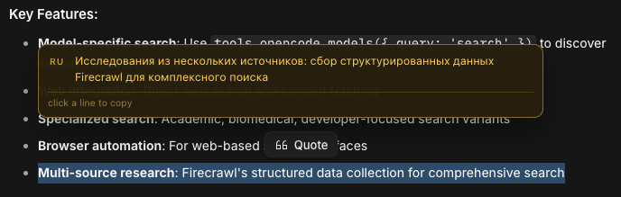
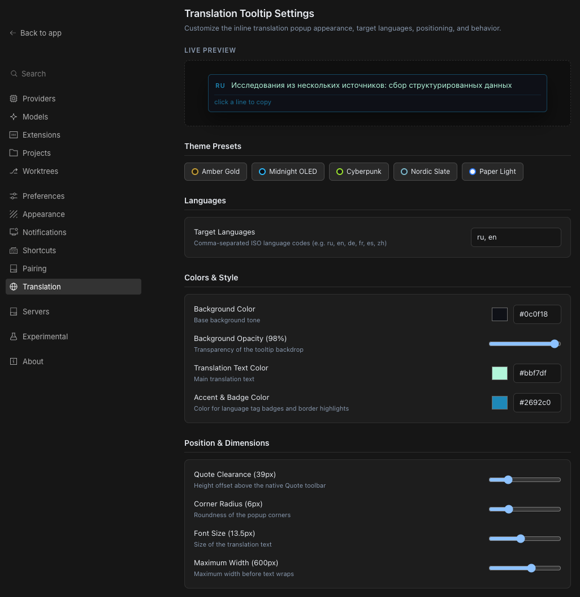
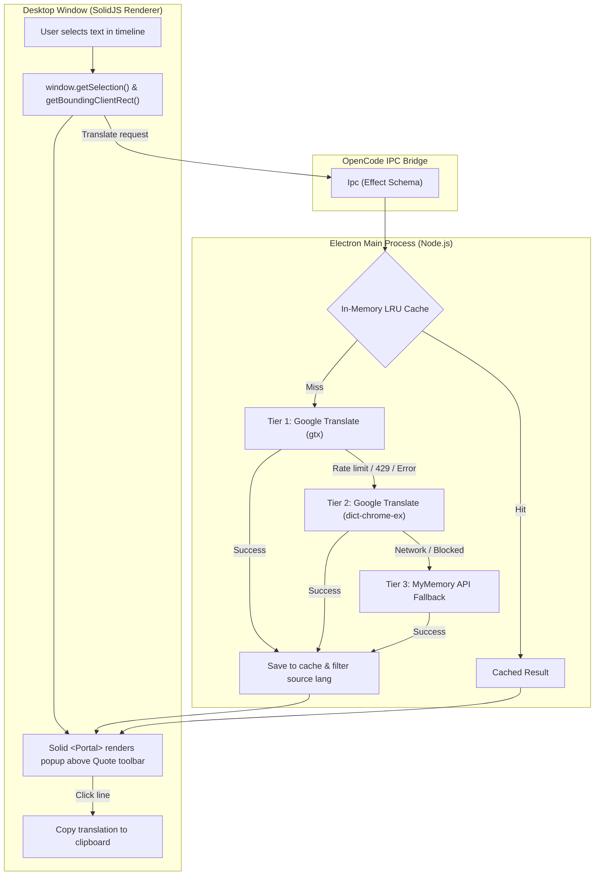

# opencode-translate-selection

> Instant inline translation tooltip on text selection for **OpenCode Desktop**.

> [!IMPORTANT]
> **Requires OpenCode Desktop v2.2.0 or newer**. This plugin relies on the GUI plugin SDK (`@opencode/plugin/gui`) and the desktop timeline selection system introduced in OpenCode 2.2.0.

Select text anywhere in the session timeline or side panels, and a floating translation popup appears automatically — positioned directly above OpenCode's native **Quote** toolbar. No hotkeys required. Click any translation line to copy it to clipboard.



---

## ✨ Features

- **Zero-friction workflow**: Just select text with your mouse. The translation appears automatically after a subtle 140ms debounce.
- **Smart positioning**: Floats cleanly **above** the built-in `[ ❝ Quote ]` toolbar (`QUOTE_CLEARANCE = 52px`), without overlapping or jumping.
- **Bilingual & smart filtering**: Automatically detects the source language. Translates into your configured target languages (`RU` and `EN` by default) and drops the language matching the source (e.g. selecting English text shows only the Russian translation).
- **High-contrast warm dark theme**: Deep olive background (`rgba(43, 34, 10, 0.97)`), bright yellow translation text (`#ffd75e`), and golden language badges (`#c9a83f`).
- **One-click copy**: Click on any translated line to copy it directly to your clipboard.
- **Smart Hybrid Translation**: Simple words and phrases are translated instantly via Google Translate (~100ms). Complex multi-line structures (bullet lists, numbered steps, code blocks, parameter objects, and function calls like `tools.opencode.models()`) automatically route to the **active session's LLM** outside conversation history, preserving layout and code identifiers symbol-for-symbol.
- **Fail-safe Fallback with Token Shielding**: If the LLM times out or is busy, requests seamlessly fall back to the multi-tier MT pipeline with mathematical token shielding (`⟦0⟧`) protecting code and identifiers.
- **Multi-tier MT engine**: Google Translate (`gtx` + `dict-chrome-ex`) with MyMemory API fallback.
- **In-memory LRU cache**: Keeps up to 500 recent translations in memory for instant lookups with zero network overhead.
- **Dedicated GUI Settings**: Full-featured settings page (`/settings?tab=translate`) with an embedded Live Preview, Engine Mode selector (Auto / Fast MT / Session LLM), LLM timeout slider, 5 color presets, and geometry controls.
- **Zero runtime footprint**: Built as an ultra-compact single file bundle (`37 KB` unminified / `12 KB` gzip) running in OpenCode's SolidJS environment.

---

## 📦 Installation

### Option A: Install from GitHub

```bash
opencode plugin add github:Realmagnum/opencode-translate-selection
```

Restart OpenCode Desktop after installation.

### Option B: Local development / manual installation

1. Clone the repository into your projects directory:

```bash
git clone https://github.com/Realmagnum/opencode-translate-selection.git \
  ~/Documents/!Projects/opencode-translate-selection
cd ~/Documents/!Projects/opencode-translate-selection
npm install
npm run build
```

2. Add the absolute path to `~/.config/opencode/opencode.json`:

```jsonc
{
  "plugins": [
    "/Users/you/Documents/!Projects/opencode-translate-selection"
  ]
}
```

3. Restart OpenCode Desktop once. Subsequent edits via `npm run watch` reload the GUI automatically without needing an app restart!

---

## ⚙️ Settings (GUI)

The plugin adds a dedicated **Translation** page directly inside OpenCode Desktop's **Settings** (`/settings?tab=translate`, icon: `globe`).

<p align="center">
  
</p>

You can customize everything in real-time with an **interactive Live Preview**:
- **Theme Presets**: Switch instantly between *Amber Gold*, *Midnight OLED*, *Cyberpunk*, *Nordic Slate*, or *Paper Light*.
- **Custom Colors**: Pick custom background, text, and accent/badge colors, and adjust backdrop opacity (40% – 100%).
- **Position & Dimensions**:
  - Quote clearance height (20px – 100px).
  - Corner border-radius (0px – 24px).
  - Maximum tooltip width (300px – 800px).
  - Text font size (10px – 18px).
- **Target Languages**: Edit comma-separated ISO language codes (e.g. `ru, en, de, fr, es, zh`).
- **Behavior**: Adjust selection debounce delay (60ms – 400ms) and character limits.
- **Reset**: Restore defaults with one click.

All changes are saved automatically via OpenCode's `Store.global` and apply instantly without restarting OpenCode.

---

## 🛠️ How It Works



1. **Window setup (`src/gui.tsx`)**: Mounts a non-intrusive reactive surface into the `window.bottom` slot.
2. **Selection & Popup (`src/popup.tsx`)**: Tracks mouse release on the document, reads the active `Selection` range, measures coordinates, and portals a fixed-position popup above the native Quote toolbar.
3. **Electron Main Bridge (`src/translate.ts`)**: Translation requests run in the Electron main process via typed OpenCode `Ipc`, bypassing renderer CORS or Content Security Policy restrictions completely.

---

## ⚠️ Known Limitations

- **DOM text only**: Works across the chat timeline, tool cards, markdown messages, and sidebar panels. Does **not** work on text inside the integrated terminal, because the terminal renders to an HTML5 canvas (ghostty-web) where text selection does not produce DOM nodes.
- **Input fields**: Text selection inside textareas, inputs, or the prompt composer is intentionally ignored to avoid interfering with typing.

---

## 💻 Development

```bash
npm run typecheck   # Typecheck TypeScript against @opencode/plugin
npm test            # Run unit tests (detector, shield, formatter, llm-engine)
npm run build       # Build dist/gui-experimental.cjs (Vite + Solid)
npm run watch       # Watch & rebuild on changes (auto-reloads GUI in OpenCode)
```

### Why is `node_modules` so large?

`node_modules` (~200 dependencies) contains **only build-time tools** (`vite`, `esbuild`, `rollup`, `typescript`, `@babel/*` for JSX). When built, the entire plugin compiles into **a single compact bundle** (`dist/gui-experimental.cjs`, ~37 KB / 12 KB gzip). In OpenCode Desktop at runtime, **none** of `node_modules` is loaded or used; SolidJS and Effect are provided by OpenCode itself.

---

## 📄 License

[MIT](LICENSE) © 2026 [Realmagnum](https://github.com/Realmagnum)
