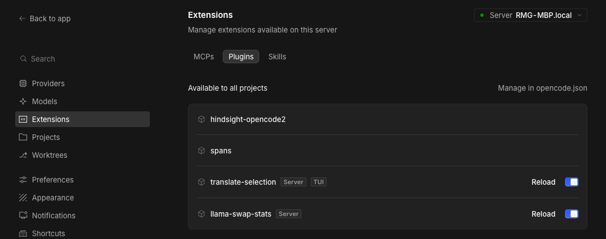
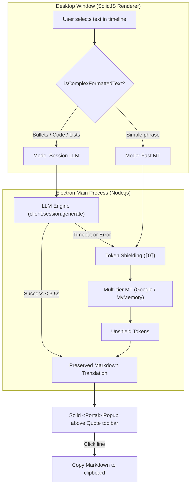

<div align="center">

# opencode-translate-selection

[](https://opencode.ai/)
[](https://opencode.ai/)
[](https://github.com/Realmagnum/opencode-translate-selection/actions)
[](https://www.typescriptlang.org/)
[](https://www.solidjs.com/)
[](LICENSE)

**Instant inline translation tooltip on text selection for OpenCode Desktop & Full Terminal TUI Support with Smart Hybrid LLM/MT routing — supports all languages.**

<br>


</div>

---

> [!IMPORTANT]
> **Requires OpenCode v2.2.0 or newer**.
> - **In OpenCode Desktop**: Provides a floating translation tooltip on mouse selection directly above the native **Quote** toolbar.
> - **In OpenCode TUI / Terminal**: Provides leader keybinds (`<leader>t`, `<leader>tl`, `<leader>tp`), slash commands (`/translate`), an interactive translation side panel, and instant clipboard support.

---

## ✨ Features

- **Zero-friction workflow**: Just select text with your mouse. The translation appears automatically after a subtle 140ms debounce.
- **Smart positioning**: Floats cleanly **above** the built-in `[ ❝ Quote ]` toolbar (`QUOTE_CLEARANCE = 52px`), without overlapping or jumping.
- **Smart Hybrid Translation**:
  - **Simple phrases & words**: Translated instantly via Google Translate (~100ms) with zero token usage.
  - **Complex structures & code**: Multi-line selections (bullet lists `•`, numbered steps `1.`, function calls like `tools.opencode.models()`, parameter objects) automatically route to the **active session's LLM** outside conversation history.
  - **Zero context pollution**: LLM translations run via `client.session.generate()`, so they never add messages to your chat or consume conversation context.
- **Fail-safe Fallback with Token Shielding**: If the LLM times out (> 3.5s) or is busy, requests seamlessly fall back to the multi-tier MT pipeline with mathematical token shielding (`⟦0⟧`) protecting code and identifiers.
- **Universal Language Support & Smart Filtering**: Works with **any language** supported by Google Translate (130+ languages) and your session's LLM — including Chinese, Japanese, Korean, Russian, English, German, French, Spanish, and more. Automatically detects the source language, translates into your configured target languages (`ru, en` by default or any custom list in Settings), and intelligently hides the target that matches the source (e.g. selecting English text shows only Russian; selecting Chinese or Japanese displays Russian and English; or configure a single target like `ru` to translate everything exclusively into Russian).
- **Structured Popup Rendering**:
  - Clean bullet tags (`•`), numbered steps (`1.`), and indentations.
  - Inline code highlighted in monospace font on subtle background chips: `<code style="...">`.
  - Subtle `LLM` tag badge when translated via session model.
  - Vertical scroll containment (`maxHeight = 420px`) for long multi-item lists.
- **High-contrast warm dark theme**: Deep olive background (`rgba(43, 34, 10, 0.97)`), bright yellow translation text (`#ffd75e`), and golden language badges (`#c9a83f`).
- **One-click copy**: Click on any translated block to copy full formatted Markdown to your clipboard.
- **Multi-tier MT engine**: Google Translate (`gtx` + `dict-chrome-ex`) with MyMemory API fallback.
- **In-memory LRU cache**: Keeps up to 500 recent translations in memory for instant lookups with zero network overhead.
- **Dedicated GUI Settings**: Full-featured settings page (`/settings?tab=translate`) with an embedded Live Preview, Engine Mode selector (Auto / Fast MT / Session LLM), LLM timeout slider, 5 color presets, and geometry controls.
- **Zero runtime footprint**: Built as an ultra-compact single file bundle (`37 KB` unminified / `12 KB` gzip) running in OpenCode's SolidJS environment.

---

## 📦 Installation

### Option A: Install from GitHub

```bash
opencode plugin add github:Realmagnum/opencode-translate-selection
```

Restart OpenCode Desktop after installation.

### Option B: Local development / manual installation

1. Clone the repository:

```bash
git clone https://github.com/Realmagnum/opencode-translate-selection.git \
  ~/Documents/!Projects/opencode-translate-selection
cd ~/Documents/!Projects/opencode-translate-selection
npm install
npm run build
```

2. Add the absolute path to `~/.config/opencode/opencode.json`:

```jsonc
{
  "plugins": [
    "/Users/you/Documents/!Projects/opencode-translate-selection"
  ]
}
```

3. Restart OpenCode Desktop once. Subsequent edits via `npm run watch` reload the GUI automatically in real time without needing an app restart!

---

## 💻 Terminal (TUI) Usage

When running OpenCode in your terminal (`opencode`), the plugin automatically activates its TUI component with zero configuration required.

### ⌨️ Keybindings & Commands

| Keybind | Command / Slash | Description |
|---|---|---|
| `alt+t` | `/translate [text]` (or `/tr`) | **Translate clipboard text** (or custom prompt if empty / argument passed). Shows an interactive popup dialog with quick copy. |
| `alt+shift+t` | `/translate-last` (or `/trl`) | **Translate last assistant message** from current session without cluttering chat history. |
| `alt+p` | `/translate-panel` (or `/trp`) | **Toggle side panel** (`session.panel`) for persistent side-by-side translation reading. |
| — | `/translate-config` | Open interactive TUI settings (target languages, engine mode: Auto / Fast MT / LLM). |

*(All commands are also accessible from the command palette via `Ctrl+P`).*

### 📑 Interactive Side Panel Features

When the translation panel is open (`alt+p` or `/translate-panel`), it receives keyboard shortcuts directly when focused:
- `t`: Translate current clipboard text
- `l`: Translate last assistant turn in current session
- `y`: Copy current formatted Markdown translation to clipboard
- `m`: Cycle engine mode (`AUTO` → `FAST` → `LLM` → `AUTO`)
- `f`: Toggle panel full-screen view
- `q` or `Esc`: Close the panel

---

## ⚙️ Settings (GUI)

The plugin integrates seamlessly with OpenCode Desktop's Settings:

### 1. Plugin Management (`Settings > Extensions > Plugins`)

The plugin automatically registers with OpenCode's native extensions manager. You can reload its GUI or toggle it on/off at any time without restarting OpenCode:

<p align="center">
  
</p>

### 2. Dedicated Configuration (`Settings > Translation`)

A dedicated **Translation** page is added directly to OpenCode Desktop's Settings (`/settings?tab=translate`, icon: `globe`).

<p align="center">
  
</p>

You can customize everything in real-time with an **interactive Live Preview**:
- **Engine Mode**:
  - `Auto (Smart)` *(Default)*: Google MT for single phrases; Session LLM for structured lists and code.
  - `Fast MT Only`: Always use Google / MyMemory (fastest, zero LLM usage).
  - `Session LLM Only`: Always translate using the active session's model.
- **LLM Fallback Timeout**: Configurable wait time (1.5s – 8.0s) before falling back to Google Translate.
- **Theme Presets**: Switch instantly between *Amber Gold*, *Midnight OLED*, *Cyberpunk*, *Nordic Slate*, or *Paper Light*.
- **Custom Colors**: Pick custom background, text, and accent/badge colors, and adjust backdrop opacity (40% – 100%).
- **Position & Dimensions**:
  - Quote clearance height (20px – 100px).
  - Corner border-radius (0px – 24px).
  - Maximum tooltip width (300px – 800px).
  - Maximum tooltip height (200px – 700px).
  - Text font size (10px – 18px).
- **Target Languages**: Edit comma-separated ISO language codes (e.g. `ru, en, de, fr, es, zh, ja, ko`). Supports **any language** understood by Google Translate (130+ languages) or your active LLM. Set a single code like `ru` to translate all foreign text (English, Chinese, etc.) strictly into Russian.
- **Behavior**: Adjust selection debounce delay (60ms – 400ms) and character limits (200 – 2500).
- **Reset**: Restore defaults with one click.

All changes are saved automatically via OpenCode's `Store.global` and apply instantly without restarting OpenCode.

---

## 🛠️ Architecture & How It Works



1. **Window setup (`src/gui.tsx`)**: Mounts a non-intrusive reactive surface into the `window.bottom` slot.
2. **Selection & Popup (`src/popup.tsx`)**: Tracks mouse release on the document, reads the active `Selection` range, measures coordinates, and portals a fixed-position popup above the native Quote toolbar.
3. **Electron Main Bridge (`src/translate.ts`)**: Translation requests run in the Electron main process via typed OpenCode `Ipc`, bypassing renderer CORS or Content Security Policy restrictions completely.
4. **Session LLM Generation (`src/llm-engine.ts`)**: Executes outside conversation history via `client.session.generate({ sessionID, prompt })`, producing symbol-for-symbol accurate translations without polluting the user's session.

---

## ⚠️ Known Limitations

- **DOM text only**: Works across the chat timeline, tool cards, markdown messages, and sidebar panels. Does **not** work on text inside the integrated terminal, because the terminal renders to an HTML5 canvas (ghostty-web) where text selection does not produce DOM nodes.
- **Input fields**: Text selection inside textareas, inputs, or the prompt composer is intentionally ignored to avoid interfering with typing.

---

## 💻 Development & Testing

```bash
npm run typecheck   # Typecheck TypeScript against @opencode/plugin
npm test            # Run 15 unit tests (detector, shield, formatter, llm-engine)
npm run build       # Build dist/gui-experimental.cjs (Vite + Solid)
npm run watch       # Watch & rebuild on changes (auto-reloads GUI in OpenCode)
npm run ci          # Full CI suite: typecheck + test + build
```

---

## 📄 License

[MIT](LICENSE) © 2026 [Realmagnum](https://github.com/Realmagnum)
